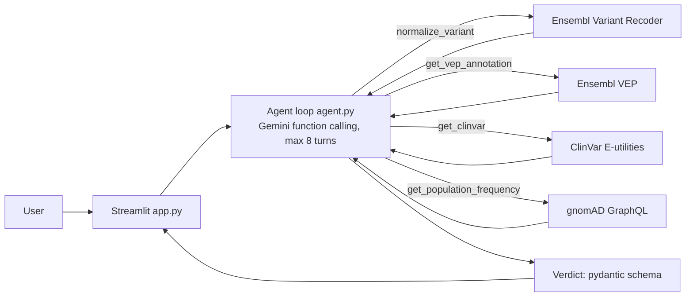

# Allele Agent

Paste a human genetic variant and an LLM agent decides which public genomics APIs to call, merges the evidence from Ensembl VEP, ClinVar and gnomAD, flags conflicts between sources, and returns a plain-English verdict with links. The Streamlit UI shows the live tool-call trace, so you can watch the agent work instead of getting a black-box answer. The tool loop is hand-written on the Google Gemini SDK (`google-genai`, free-tier model `gemini-3.8-flash`; no LangChain or LangGraph).

> Screenshot or GIF: _add here_

## Architecture



Files: `app.py` (UI), `agent.py` (tool loop, JSON repair), `tools.py` (API tools), `schemas.py` (`Verdict`).

## Accepted inputs

- rsID: `rs80357906`
- HGVS with transcript: `ENST00000357654.9:c.5266dup`, `NM_007294.4:c.5266dup`
- HGVS genomic: `17:g.43057062dup` (note: this is a different variant from rs80357906; the BRCA1 5266dup is `NC_000017.11:g.43057065dup`)

## Behaviour worth knowing (checked against the live APIs)

- **Multi-allelic rsIDs.** `rs334`, `rs113993960` and `rs1801133` each map to several alt alleles. The tool analyses the allele with the highest gnomAD frequency and reports the others in `other_alleles`.
- **Left-alignment.** The Recoder's VCF strings are not always left-aligned, and gnomAD only matches left-aligned IDs (for example F508del is `7-117559590-ATCT-A`). Indels are left-aligned using Ensembl reference sequence before the gnomAD lookup.
- **ClinVar record choice.** ClinVar's first hit for an rsID is often a haplotype record. The tool keeps single-variant records, then prefers the one whose allele matches the normalized variant, and reports `record_match` and `total_hits`.
- **VEP input.** VEP is called with the genomic HGVS from the Recoder rather than `/vep/human/id/{rsid}`, so the analysed allele is exact. The MANE Select transcript is preferred.
- **Errors.** Every API call has a 15 s timeout and one retry. Failures reach the agent as `{"error": ...}`; nothing is raised. A missing ClinVar or gnomAD record is `{"found": false}`, which counts as evidence.

## Setup

```
pip install -r requirements.txt
$env:GEMINI_API_KEY="your-key"        (free key: https://aistudio.google.com/apikey)
streamlit run app.py
```

The key is read from the `GEMINI_API_KEY` environment variable (or `GOOGLE_API_KEY`), with a fallback to `st.secrets`. Set `GEMINI_MODEL` to use a different model. Never commit the key.

## Example outputs

Not yet generated. Run each example in the app and paste the verdict here. Tool outputs for the four examples were verified live while building `tools.py`:

| Variant | ClinVar | gnomAD v4 global AF | VEP consequence |
|---|---|---|---|
| rs80357906 (BRCA1) | Pathogenic, reviewed by expert panel | 6.8e-05 | frameshift, HIGH |
| rs334 (HBB) | Pathogenic, multiple submitters, no conflicts | 0.0027 (afr 0.049) | missense, SIFT deleterious_low_confidence |
| rs113993960 (CFTR F508del) | Pathogenic, practice guideline | 0.012 | inframe deletion |
| rs1801133 (MTHFR C677T) | "drug response", reviewed by expert panel | 0.32 | missense, SIFT deleterious, PolyPhen probably_damaging |

## Evaluation

Not run yet. Planned: 20 variants with 3-star or 4-star ClinVar labels, run once with the ClinVar tool disabled (to avoid circularity) and once enabled, collapsed to pathogenic-ish, VUS and benign-ish, with a confusion matrix. `run_agent(..., enabled_tools=...)` already supports disabling tools.

## Limitations

- Not clinical grade. No full ACMG criteria implementation.
- GRCh38 only.
- Depends on third-party API uptime. Ensembl in particular can be slow or time out.
- ClinVar labels such as "drug response" or "risk factor" are not pathogenicity calls, and the agent has to reason about that.

## Data sources and citations

- Ensembl VEP and Variant Recoder: McLaren et al., Genome Biology 2016; Yates et al., Nucleic Acids Research 2024.
- ClinVar: Landrum et al., Nucleic Acids Research 2018.
- gnomAD: Karczewski et al., Nature 2020; Chen et al., Nature 2024.
